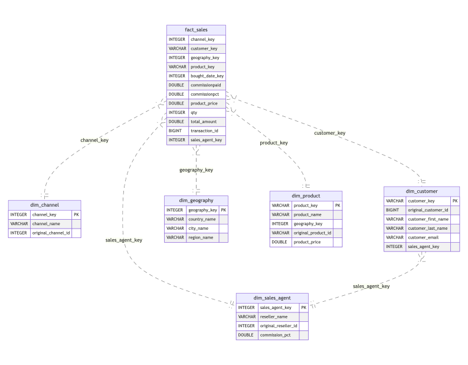

# Postcard Company — Dataform


A **Dataform v3** project on **BigQuery** for an imaginary postcard company that
sells directly and through resellers across Europe.

It is [postcard-company-datamart](https://github.com/cnstlungu/postcard-company-datamart)
(dbt-core + DuckDB) converted to Dataform by
[dbt2dataform](https://github.com/cnstlungu/dbt2dataform). Like the
portable-data-stack repos (Airflow, Dagster, Mage, SQLMesh), it builds from a
pinned datamart release, so the two cannot drift apart. CI regenerates the
project from that release and fails if the committed files differ.

> **Disclaimer:** This is an example project provided for educational purposes only, made available as-is without any warranties or guarantees. All data is artificially generated using the [Faker](https://faker.readthedocs.io/) library — any resemblance to real persons, companies, or transactions is purely coincidental. The project is not intended for production use.

---

## What it demonstrates

- **The same warehouse as the dbt project, on BigQuery.** The conversion was
  checked by running it against the same generated files as dbt on DuckDB.
  All 23 tables matched row for row, both after a full build and after an
  incremental run.
- **GCS external tables defined in SQL.** Ingestion is part of the Dataform
  DAG: one `operations` action per Parquet file, with `hasOutput: true` so the
  rest of the project can `ref()` it.
- **Incremental tables.** `uniqueKey` MERGEs, `onSchemaChange`, and
  `${when(incremental(), ...)}` branches that filter on a watermark of the
  table's own contents.
- **Partitioning and clustering.** The incremental tables carry their date as
  `bought_date_key` (`20260913`), so they use integer-range partitioning, one
  partition per year.
- **Data quality.** dbt's tests become built-in assertions (`uniqueKeys`,
  `nonNull`, `rowConditions`) or assertion files. dbt's model contracts become
  assertions on `INFORMATION_SCHEMA.COLUMNS`, plus unenforced primary keys. Source
  freshness becomes an assertion too.
- **Surrogate keys identical to dbt's.** `includes/dbt_utils.js` reproduces
  `dbt_utils.generate_surrogate_key` exactly, so a key computed here matches
  the one dbt computes for the same row.
- **No hardcoded configuration.** The committed `workflow_settings.yaml` holds
  placeholders. Your GCP project and bucket are passed in at run time.

---

## Data model



### Layers

| Layer | Dataset | Description |
|---|---|---|
| sources | `parquet_input` | External tables over the Parquet files in GCS |
| raw | `postcard_company_raw` | Tables that rename columns and add `loaded_timestamp`, plus the `geography` seed |
| staging | `postcard_company_staging` | Cleaned, typed, deduplicated, surrogate-keyed models |
| core | `postcard_company_core` | Dimensions and the fact table |
| assertions | `postcard_company_assertions` | Data quality checks |

### Dimensions
- `dim_channel`
- `dim_customer`
- `dim_date`
- `dim_geography`
- `dim_product`
- `dim_sales_agent`

### Facts
- `fact_sales`: incremental, partitioned by year of `bought_date_key`, clustered
  by channel and sales agent

---

## Prerequisites

- [Google Cloud SDK](https://cloud.google.com/sdk/docs/install) (`gcloud`, `bq`)
- [Dataform CLI](https://cloud.google.com/dataform/docs/use-dataform-cli) **3.0.71**
  or newer: `npm i -g @dataform/cli@3.0.71`. Older CLIs silently ignore
  `onSchemaChange`.
- A GCP project with BigQuery enabled, and a GCS bucket for the Parquet files
- Docker, to run the datamart's data generator

---

## Getting started

### 1. Authenticate with GCP

```bash
gcloud auth application-default login
```

### 2. Set up Dataform credentials

Create `.df-credentials.json` in the project root (it is gitignored):

```json
{
  "projectId": "your-gcp-project-here",
  "location": "EU"
}
```

### 3. Generate the source data

The data comes from the datamart's generator, built straight from the release
this project is generated from:

```bash
docker build -t postcard-generator \
  "https://github.com/cnstlungu/postcard-company-datamart.git#v1.3.0:generator"
docker run --rm -e INPUT_FILES_PATH=/data -v "$PWD/data:/data" postcard-generator
```

It writes seven Parquet files to `data/`: 100,000 direct sales, two reseller
feeds of 100,000 rows each, and the customers, products, channels and
resellers they refer to. Pass `-e N_TRANSACTIONS=...`, `-e SEED=...`,
`-e DATA_WINDOW_MONTHS=...` or `-e DATA_END_DATE=...` to change the size,
randomness or date window. The
[datamart README](https://github.com/cnstlungu/postcard-company-datamart#readme)
describes each setting.

### 4. Upload the Parquet files to GCS

```bash
gcloud storage cp data/*.parquet gs://your-bucket-here/parquet/
```

### 5. Run the pipeline

Pass your project and bucket on the command line:

```bash
dataform run \
  --default-database your-gcp-project-here \
  --vars input_files_path=gs://your-bucket-here/parquet
```

The same two flags work with every command below. You can put your values in
`workflow_settings.yaml` instead, but don't commit them: CI regenerates that
file and fails if it changed.

```bash
# One action
dataform run --actions postcard_company_core.fact_sales ...

# Everything with a tag: sources, raw, staging, core, assertions
dataform run --tags staging ...

# Rebuild the incremental tables from scratch
dataform run --full-refresh ...
```

### 6. Schedule it

In BigQuery Dataform, connect this repository and create a release
configuration. Set its compilation overrides to your project, and set the
`input_files_path` var. Then create a workflow configuration for the daily
build:

```text
Tag: schedule_daily
Include dependencies: true
Include dependents: false
Full refresh: false
```

`schedule_daily` is on every source, raw, staging and core action. Dataform
gives built-in assertions their table's tags, so the daily build also runs
the uniqueness, not-null and row-condition checks. The contract, freshness and
other standalone assertions carry the `assertions` tag. Schedule them
separately, or run them after the build:

```text
Tag: assertions
Include dependencies: true
Include dependents: false
Full refresh: false
```

---

## How it is generated

Everything except `README.md`, `LICENSE`, `resources/`, `scripts/`,
`dbt2dataform.yml`, `.gitignore` and `.github/` is generated. Don't edit the
generated files by hand. Change the dbt project upstream, or the overrides in
`dbt2dataform.yml`, and regenerate:

```bash
./scripts/regenerate.sh
```

The script clones the datamart at `DATAMART_REF` and runs dbt2dataform at
`DBT2DATAFORM_REF`. Both are pinned at the top of the script. It needs
[uv](https://docs.astral.sh/uv/). To try changes before they are released,
point it at local checkouts:

```bash
DATAMART_DIR=../postcard-company-datamart DBT2DATAFORM=../dbt2dataform ./scripts/regenerate.sh
```

- `dbt2dataform.yml` holds the placeholder project and bucket. It also holds
  the Dataform config that a DuckDB project cannot express: layer tags,
  `schedule_daily`, partitioning and clustering.
- `CONVERSION_REPORT.md` lists every file's dbt origin, and whatever was
  renamed or behaves differently from dbt.
- To move to a new datamart release: cut the datamart tag, bump `DATAMART_REF`,
  regenerate, and commit the result.

---

## Moving from the hand-written version

Until October 2026 this repo was a hand-written port of the dbt project. It
differed from dbt in places:

- Its surrogate keys used `|` and an empty string for NULL. dbt uses `-` and
  `_dbt_utils_surrogate_key_null_`.
- Its `dim_date` started weeks on Sunday and its week keys weren't ISO weeks.
- It had an SCD2 `dim_product` that never produced a second version.

If you ran it, the generated version changes keys, columns and partitioning.
BigQuery can't repartition a table in place, even in a full refresh. So drop
the incremental tables first, then rebuild everything:

```bash
bq rm -f -t your-gcp-project-here:postcard_company_staging.staging_transactions_main
```
```bash
bq rm -f -t your-gcp-project-here:postcard_company_staging.staging_reseller_type1_sales
```
```bash
bq rm -f -t your-gcp-project-here:postcard_company_staging.staging_reseller_type2_sales
```
```bash
bq rm -f -t your-gcp-project-here:postcard_company_core.fact_sales
```
```bash
dataform run --full-refresh --default-database your-gcp-project-here --vars input_files_path=gs://your-bucket-here/parquet
```

The external tables now live in `parquet_input` rather than
`postcard_company_raw_input`, which nothing uses any more. The Parquet file
names haven't changed, so the files you already uploaded still work.

---

## Local development

```bash
dataform compile        # checks SQL structure and ref() resolution; needs no credentials
./scripts/regenerate.sh # rebuilds the project from the pinned datamart release
```

CI runs both: it compiles the project, and it fails if regenerating changes
anything.

---

## Project structure

```
.
├── dbt2dataform.yml          # Conversion settings and Dataform-only overrides
├── scripts/regenerate.sh     # Regenerates everything below from the datamart
├── workflow_settings.yaml    # Generated; placeholders for project and bucket
├── CONVERSION_REPORT.md      # Generated; what came from where, what differs
├── .dbt2dataform.json        # Generated; the files the last run wrote
├── includes/                 # Generated; surrogate keys, contract helper
└── definitions/              # Generated
    ├── sources/              # External tables over GCS Parquet
    ├── raw/                  # Renaming tables
    ├── seeds/                # The geography seed, inlined
    ├── staging/              # Cleaned, typed, deduplicated models
    ├── core/                 # Dimensions and the fact table
    └── assertions/           # Tests, contracts and freshness checks
```
